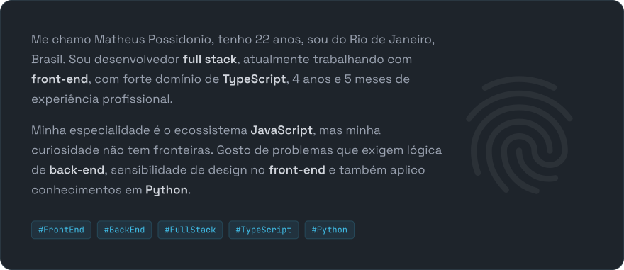
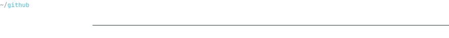

<!-- Os SVGs de assets/ são gerados por scripts/generate.mjs (veja scripts/README.md) -->

<a href="https://p0sseid0n.dev/">
  <picture>
    <source media="(prefers-color-scheme: light)" srcset="./assets/hero-light.svg">
    
  </picture>
</a>

  <a href="https://p0sseid0n.dev/"><picture><source media="(prefers-color-scheme: light)" srcset="./assets/btn-site-light.svg"></picture></a>&nbsp;&nbsp;
  <a href="https://docs.google.com/document/d/1rLACVhPBc8_sdbDZ1i05ssPZ02NsAOq3yxJHEB-PdH4/export?format=pdf&tab=1"><picture><source media="(prefers-color-scheme: light)" srcset="./assets/btn-cv-light.svg"></picture></a>

 

<picture>
  <source media="(prefers-color-scheme: light)" srcset="./assets/title-sobre-light.svg">
  
</picture>

<picture>
  <source media="(prefers-color-scheme: light)" srcset="./assets/about-light.svg">
  
</picture>

  

<picture>
  <source media="(prefers-color-scheme: light)" srcset="./assets/title-tecnologias-light.svg">
  
</picture>

<picture>
  <source media="(prefers-color-scheme: light)" srcset="./assets/techs-light.svg">
  
</picture>

  

<picture>
  <source media="(prefers-color-scheme: light)" srcset="./assets/title-github-light.svg">
  
</picture>

  <picture>
    <source media="(prefers-color-scheme: light)" srcset="https://github-stats-extended.vercel.app/api?username=P0sseid0n&hide_rank=true&custom_title=P0sseid0n's%20GitHub%20Stats&show_icons=true&include_all_commits=true&border_radius=12&bg_color=ffffff&title_color=0a6e9e&text_color=3b4855&icon_color=0a6e9e&border_color=dde4eb">
    
  </picture>
  <picture>
    <source media="(prefers-color-scheme: light)" srcset="https://github-stats-extended.vercel.app/api/top-langs?username=P0sseid0n&layout=compact&langs_count=8&border_radius=12&bg_color=ffffff&title_color=0a6e9e&text_color=3b4855&border_color=dde4eb">
    
  </picture>

  

<picture>
  <source media="(prefers-color-scheme: light)" srcset="./assets/contact-light.svg">
  
</picture>

  <a href="mailto:matheuspossidoniom@outlook.com"><picture><source media="(prefers-color-scheme: light)" srcset="./assets/btn-email-light.svg"></picture></a>

  <a href="https://www.linkedin.com/in/matheus-possidonio/"><picture><source media="(prefers-color-scheme: light)" srcset="./assets/icon-linkedin-light.svg"></picture></a>&nbsp;
  <a href="https://x.com/notP0sseid0n"><picture><source media="(prefers-color-scheme: light)" srcset="./assets/icon-x-light.svg"></picture></a>&nbsp;
  <a href="https://discord.com/users/237313382657687552"><picture><source media="(prefers-color-scheme: light)" srcset="./assets/icon-discord-light.svg"></picture></a>

