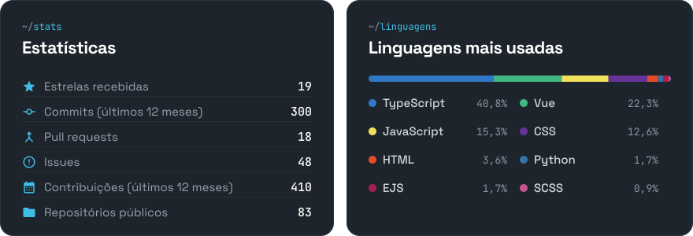

<!-- Os SVGs de assets/ são gerados por scripts/generate.mjs (veja scripts/README.md) -->

<a href="https://p0sseid0n.dev/">
  <picture>
    <source media="(prefers-color-scheme: light)" srcset="./assets/hero-light.svg">
    
  </picture>
</a>

 

<picture>
  <source media="(prefers-color-scheme: light)" srcset="./assets/title-tecnologias-light.svg">
  
</picture>

<picture>
  <source media="(prefers-color-scheme: light)" srcset="./assets/techs-light.svg">
  
</picture>

 

<picture>
  <source media="(prefers-color-scheme: light)" srcset="./assets/title-github-light.svg">
  
</picture>

<picture>
  <source media="(prefers-color-scheme: light)" srcset="./assets/github-light.svg">
  
</picture>

 

<picture>
  <source media="(prefers-color-scheme: light)" srcset="./assets/contact-light.svg">
  
</picture>

  <a href="mailto:matheuspossidoniom@outlook.com"><picture><source media="(prefers-color-scheme: light)" srcset="./assets/btn-email-light.svg"></picture></a>

  <a href="https://www.linkedin.com/in/matheus-possidonio/"><picture><source media="(prefers-color-scheme: light)" srcset="./assets/icon-linkedin-light.svg"></picture></a>&nbsp;
  <a href="https://x.com/notP0sseid0n"><picture><source media="(prefers-color-scheme: light)" srcset="./assets/icon-x-light.svg"></picture></a>&nbsp;
  <a href="https://discord.com/users/237313382657687552"><picture><source media="(prefers-color-scheme: light)" srcset="./assets/icon-discord-light.svg"></picture></a>

